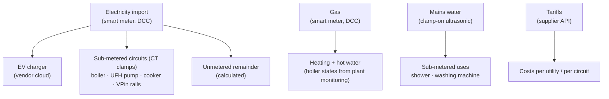

# Whole-Home Energy and Utility Metering Dashboard (Planned)

**Bringing every utility into one metering and cost view, the way a BMS energy module does: smart-meter electricity and gas, tariffs and cost tracking, EV charging, mains water and sewerage, and circuit-level sub-metering from current clamps. KPIs like baseload, heating gas per degree-day and cost per day turn the data into decisions.**

> **The short version:**
> - **Live already:** the data sources (smart-meter data, the energy supplier's tariffs and cost trackers, the EV charger, mains water metering, and current clamps on several circuits).
> - **This project:** a **metering hierarchy**, tariff-correct **costs**, **KPIs** and a dashboard.
> - **Prerequisite:** the supplier integration's entries need tidying up (161 config entries, with duplicate cost trackers).

**Portfolio position:** Management level · energy and metering (portfolio project #5). Related: [Mains water metering](https://github.com/the-control-cabinet/mains-water-metering-modbus-rtu) · [Heating plant monitoring](https://github.com/the-control-cabinet/heating-plant-monitoring-esphome) · [HA integration schedule](https://github.com/the-control-cabinet/home-assistant-integration-schedule)

---

## 1. Metering hierarchy (planned)

The pattern, as in a BMS: **main meter → sub-meters → calculated remainder**, so every kWh and litre is accounted for, and unmetered load is visible.

## 2. Data sources

| Source | Data | Path | Status |
|---|---|---|---|
| Smart-meter data service (DCC) | Electricity and gas import, near-real-time | Cloud | ✅ Live |
| Energy supplier API | Tariffs, consumption, cost trackers | Cloud | ✅ Live · ⚠️ 161 entries to tidy |
| EV charger | Charging sessions, energy | Cloud | ✅ Live |
| Mains water meter | Flow, totals, per-draw, costs (water + sewerage) | Local (Modbus RTU) | ✅ Live |
| CT clamps | Boiler, UFH pump, cooker, VPin rails | Local (ESPHome) | 🚧 Partly fitted |
| Grid carbon intensity | gCO₂/kWh | Public API | ✅ Live |
| Outdoor temperature | Degree-day calculation | Weather | ✅ Live |

## 3. KPIs (planned)

| KPI | Definition | Why |
|---|---|---|
| **Electrical baseload** | Minimum overnight import (W) | Finds always-on waste |
| **Cost per day** (per utility) | Tariff-correct, including standing charges | The bill, in advance |
| **Heating gas per degree-day** | Gas kWh ÷ heating degree-days (base 15.5 °C) | Weather-normalised heating efficiency; shows the effect of OpenTherm and controls changes |
| **Boiler cycles per hour** | From the plant monitoring states | Short-cycling indicator (before/after OpenTherm) |
| **Water per person per day / overnight flow** | From the water meter | Leak and usage indicator |
| **Unmetered remainder** | Main minus sub-meters | Coverage of the metering |
| **Carbon** | kWh × grid intensity | Shift flexible loads (EV) to low-carbon periods |

## 4. Tidy-up first: the supplier integration
- **161 config entries** for the energy supplier integration, most likely **duplicate cost trackers or target-rate sensors** from earlier set-up attempts.
- Plan:
  1. List them.
  2. Keep one cost tracker per meter, per purpose.
  3. Delete the duplicates.
  4. Document the naming.
- Then build the costs on the clean set.

## 5. Implementation plan
1. Tidy the supplier entries; confirm the meter entities (electricity, gas).
2. Configure HA's **Energy dashboard**: grid import, gas, water, individual devices (EV, CT circuits).
3. **Utility-meter helpers** for daily/monthly/billing-period totals (example: [config/utility-meters.example.yaml](config/utility-meters.example.yaml)).
4. **Template KPIs:** baseload, degree-days, gas per degree-day, cost per day.
5. A dashboard: a Sections layout with per-utility cards, KPI tiles and comparisons.
6. Alerts: high baseload, an unusual daily cost, overnight water flow.

## 6. Roadmap
- [ ] Supplier entry tidy-up.
- [ ] Energy dashboard configuration.
- [ ] KPIs and dashboard.
- [ ] Long-term storage (InfluxDB + Grafana) for year-on-year comparisons.
- [ ] Before/after report for the OpenTherm stage (gas per degree-day, cycles per hour).

## 7. Skills demonstrated (on completion)

| Skill | Evidence |
|---|---|
| Metering hierarchy | Main → sub → remainder across electricity, gas and water |
| Tariff and cost modelling | Unit rates, standing charges, billing periods |
| Energy KPIs | Baseload, degree-day normalisation, cycles per hour |
| M&V thinking | Before/after measurement for controls changes |

📺 [The Control Cabinet on YouTube](https://www.youtube.com/channel/UC5Cupmz7vlfcodpCX7k8iuQ)

*Built and documented by James · part of [The Control Cabinet BMS portfolio](https://github.com/the-control-cabinet). MIT Licence.*
